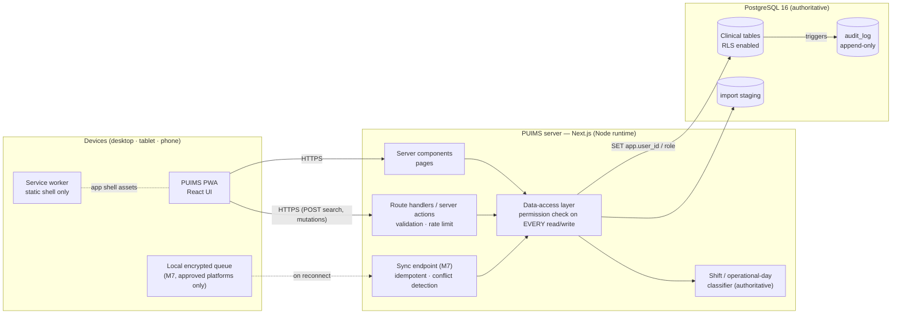
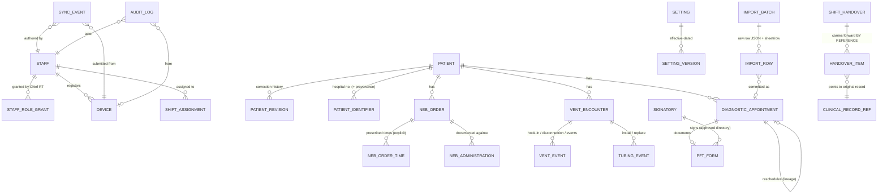

# PUIMS — Milestone 0: Inspection, Assumptions, Architecture and Plan

Status: **complete** (2026-11-22). Inputs inspected: every file in `docs/handoff/` (master prompt, product requirements, architecture/offline design, import/PFT spec, security checklist, Figma handoff, dashboard prototype, starter schema, START_HERE, BUILD_TRACKER).

This document is the working source of truth for _how_ PUIMS is being built. The handoff documents remain the source of truth for _what_.

---

## 1. Summary of what was found

| Input                  | Key take-aways                                                                                                                                                            |
| ---------------------- | ------------------------------------------------------------------------------------------------------------------------------------------------------------------------- |
| Master prompt          | Modular monolith; 16 modules; milestones 0–8; offline modes A/B/C; no clinical inference; synthetic data only; definition of done.                                        |
| Product requirements   | IA (5 nav groups), per-module fields and rules, metric definitions required, Asia/Manila shifts, carry-forward by reference.                                              |
| Architecture & offline | Central PostgreSQL authoritative; immutable offline events with client UUIDs; never last-write-wins; offline PHI only on platforms that pass review; boundary test times. |
| Import & PFT spec      | Workbook has inconsistent monthly sheets; 10-step staged import; never auto-fix years or merge on name; PFT form section list and form ID `AS-PUL-PFT-006`.               |
| Security checklist     | Sections A–H are the acceptance gate. Release gate H requires hospital approvals.                                                                                         |
| Figma handoff          | Tokens (bg `#F7F7F4`, text `#252824`, border `#E6E8E3` …), 22 core frames, phone = cards + bottom nav, status not by colour alone.                                        |
| Prototype HTML         | Visual direction only. Its chart heights are explicitly illustrative and were **not** used.                                                                               |
| Starter schema         | Useful seed but needs substantial revision — see §7.                                                                                                                      |

No source workbooks and no patient data were included in the handoff, and none were requested.

## 2. Assumptions (proceeding on these unless told otherwise)

| ID   | Assumption                                                                                                                   | Why it is safe to proceed                                                                                                      |
| ---- | ---------------------------------------------------------------------------------------------------------------------------- | ------------------------------------------------------------------------------------------------------------------------------ |
| A-01 | Single hospital site, single Pulmonary Unit, one timezone (`Asia/Manila`, UTC+8, no DST).                                    | Time code is nevertheless DST-correct and tested with `America/New_York`.                                                      |
| A-02 | Every authenticated RT may read all Pulmonary Unit patients (unit-scoped, not ward-scoped).                                  | Permission matrix is central (`src/lib/authz/permissions.ts`); narrowing later is a policy change, not a redesign.             |
| A-03 | The Chief RT has every RT permission plus administration.                                                                    | Matches "view all … as authorized".                                                                                            |
| A-04 | RTs _transcribe_ physician orders as an order reference (they do not originate orders).                                      | PRD §5 "authorized order reference / prescriber". Order entry permission is separate (`orders:enter`) so it can be restricted. |
| A-05 | Two RTs per shift in synthetic rosters.                                                                                      | Demo only; roster size is data, not code.                                                                                      |
| A-06 | Monthly trends use local calendar months; daily reports offer both operational and calendar days.                            | PRD §13 asks for both; month bucketing by operational day can be added if requested.                                           |
| A-07 | 24-hour clock everywhere; English UI.                                                                                        | Clinical convention; i18n not requested.                                                                                       |
| A-08 | Next.js 16 (App Router) + React 19 + TypeScript + Tailwind 4 + PostgreSQL 16.                                                | Suggested stack; versions current and maintained.                                                                              |
| A-09 | Milestone 1 uses an in-memory synthetic dataset behind the same data-access functions Milestone 2 will back with PostgreSQL. | Keeps M1 runnable without a database while preserving the server-side authorization seam.                                      |

## 3. Unresolved decisions (policy register)

None of these block Milestones 1–2 with synthetic data. Items marked **blocks M#** must be answered before that milestone can be called done.

| ID   | Decision needed                                                                                                                                             | Owner                               | Default used until decided                                                                                                                                                                                                                                                                                                                                                                                                               | Blocks                  |
| ---- | ----------------------------------------------------------------------------------------------------------------------------------------------------------- | ----------------------------------- | ---------------------------------------------------------------------------------------------------------------------------------------------------------------------------------------------------------------------------------------------------------------------------------------------------------------------------------------------------------------------------------------------------------------------------------------- | ----------------------- |
| U-01 | Hosting topology: hospital on-prem LAN server, approved cloud, or both (and which DB is authoritative).                                                     | Hospital IT                         | Design supports either; one authoritative DB per topology.                                                                                                                                                                                                                                                                                                                                                                               | Production              |
| U-02 | Identity: hospital SSO (OIDC/SAML/AD) available, or app-managed accounts with MFA?                                                                          | Product owner                       | **Decided 2026-11-22: accounts managed inside PUIMS** (ADR-0006).                                                                                                                                                                                                                                                                                                                                                                        | ✅                      |
| U-03 | Which device platforms may hold offline PHI (managed iOS/Android? shared ward PCs?).                                                                        | IT + DPO                            | **Approved (product owner, 2026-11-23).** Built as described in ADR-0007. On the hospital server, set `PUIMS_OFFLINE_POLICY_APPROVED=true` (a deployment setting, deliberately not changed in code), then the Chief RT approves each device.                                                                                                                                                                                             | ✅ (enable on deploy)   |
| U-04 | change-of-tubing (ventilator circuit) interval (7 d), "upcoming" window (48 h), "due" rule, exceptions.                                                                                 | Infection prevention + Chief RT     | **Approved as built (product owner, 2026-11-23: “everything is approved”).** 7 d / 48 h / due-this-operational-day, labelled _policy-pending_.                                                                                                                                                                                                                                                                                           | ✅                      |
| U-05 | Final status vocabularies (nebulization, diagnostics).                                                                                                      | Pulmonary Unit                      | **Approved as built (product owner, 2026-11-23: “everything is approved”).** Lists in `src/lib/clinical/vocabulary.ts`.                                                                                                                                                                                                                                                                                                                  | ✅                      |
| U-06 | PFT procedure catalogue.                                                                                                                                    | Pulmonary Unit                      | **Approved as built (product owner, 2026-11-23: “everything is approved”).** Raw procedure labels kept on every appointment; booking offers three example labels from the source workbook only as suggestions; no catalogue mapping.                                                                                                                                                                                                     | ✅                      |
| U-07 | Approved sex values.                                                                                                                                        | Product owner                       | **Decided 2026-11-22: Male or Female only.** Blank allowed only for imported rows awaiting review (never guessed).                                                                                                                                                                                                                                                                                                                       | ✅                      |
| U-08 | May patient contact information be stored at all? If so, who may see it?                                                                                    | DPO                                 | **Decided 2026-11-23 (privacy officer approval, relayed by the product owner): may be stored.** Kept exactly as written in `contact_note` (never parsed as a phone number); shown only on the appointment page; each view audited; not in lists, exports or notifications.                                                                                                                                                               | ✅                      |
| U-09 | May payment classification be stored?                                                                                                                       | DPO + admin                         | **Decided 2026-11-23 (privacy officer approval): may be stored.** Optional on booking; imported from the workbook.                                                                                                                                                                                                                                                                                                                       | ✅                      |
| U-10 | Is the digital PFT form the legal record or a worksheet? Current facility header, form revision, Salbutamol template sentence, signature/approval workflow. | Product owner / clinical governance | **Decided: official clinical record; the hospital PFT guide is used exactly as is (2026-11-23).** Settings → “Load from the hospital's PFT guide workbook” takes the header/address lines, item 6, form code and logo byte-for-byte (no spelling or wording changes) as a hospital-confirmed template version.                                                                                                                           | ✅                      |
| U-11 | One handover per shift, or one per outgoing RT per shift?                                                                                                   | Product owner                       | **Decided 2026-11-22: one per shift.**                                                                                                                                                                                                                                                                                                                                                                                                   | ✅                      |
| U-12 | Retention, correction and deletion periods.                                                                                                                 | DPO / records                       | Nothing is hard-deleted; voids only. **2026-11-23: retaining the original import workbook approved** — stored encrypted with the batch, Chief RT download with step-up (audited); erased if a staged batch is discarded. Retention periods still needed.                                                                                                                                                                                 | Production              |
| U-13 | Hospital patient number: always available? format? Emergency/unidentified patient registration?                                                             | Product owner                       | **Decided 2026-11-22: optional** (unique when entered). No offline/emergency registration.                                                                                                                                                                                                                                                                                                                                               | ✅                      |
| U-14 | Inactivity lock duration and which actions need re-authentication.                                                                                          | IT security                         | 15 min idle / 12 h max session; step-up re-authentication for account, device, settings, signatory/template changes, PFT signing/finalizing/amending, import commit/reversal and offline device approval.                                                                                                                                                                                                                                | Confirm                 |
| U-15 | Data residency / vendor approval if cloud is used (e.g., Supabase).                                                                                         | DPO + IT                            | Local PostgreSQL; no cloud project.                                                                                                                                                                                                                                                                                                                                                                                                      | Production              |
| U-16 | Downtime procedure (paper fallback) that PUIMS offline mode must align with.                                                                                | Chief RT                            | Offline notice and capture page tell users to document on paper whenever PUIMS cannot save; offline capture covers only two workflows.                                                                                                                                                                                                                                                                                                   | Before production       |
| U-17 | Who may enter nebulization orders?                                                                                                                          | Product owner                       | **Decided 2026-11-22: Respiratory Therapists only** (not the Chief RT). Enforced by app permission and database policy.                                                                                                                                                                                                                                                                                                                  | ✅                      |
| U-18 | Pulmonologist signature on the PFT record: PUIMS accounts for pulmonologists (e-signature), or wet signature on the printed form recorded by an RT?         | Clinical governance + IT            | **Decided 2026-11-23: e-signature as in the Excel guide.** Each approved signatory carries their signature image (from the guide's signature sheets, accepted one by one by the Chief RT, or uploaded). The RT's image prints when they sign; the finalizing RT applies the pulmonologist's approved e-signature with an attestation (method `E_SIGNATURE_APPLIED_BY_RT`, audited). Wet signature on the printed copy remains available. | ✅                      |
| U-19 | Import of the real scheduling workbook: approved environment, reviewers, and what to do with rows that cannot be resolved.                                  | DPO + Chief RT                      | **Approved (product owner, 2026-11-23).** Import the real workbook via the Import Center on the hospital server; text is kept exactly as written and the original file is retained encrypted. (The copy uploaded to the development cloud session was never opened.)                                                                                                                                                                     | ✅ (on hospital server) |

## 4. Architecture

Modular monolith: one Next.js application containing UI, server-side data-access layer and API, backed by one authoritative PostgreSQL database per deployment.



**Deployment profiles** (`PUIMS_DEPLOYMENT_PROFILE`): `development`, `uat`, `lan` (hospital on-prem endpoint — UI shows _Local server_, mode B), `cloud`. Demo mode is refused on `lan`/`cloud`.

**Key boundaries**

- Browser never talks to PostgreSQL. No database credentials or service keys in client bundles.
- `src/server/*` is `server-only`. Pages call the DAL; the DAL checks permissions and (from M2) sets the PostgreSQL session context so RLS enforces the same rule a second time.
- `src/lib/*` is pure and isomorphic (time, tubing, metrics, permissions) so offline clients (M7) reuse the same rules for _provisional_ display; the server recomputes authoritatively on sync.

## 5. Repository tree (Milestone 1)

```
puims/
├─ .github/workflows/ci.yml        format · lint · typecheck · unit · build · e2e · npm audit
├─ docs/
│  ├─ 00-MILESTONE-0-PLAN.md        this file
│  ├─ THREAT_MODEL.md
│  ├─ OFFLINE_BEHAVIOR_MATRIX.md
│  ├─ BUILD_TRACKER.md
│  ├─ adr/0001…0005-*.md
│  └─ handoff/                      original handoff package (unchanged)
├─ public/  sw.js · offline.html · icons/
├─ scripts/generate-icons.mjs
├─ src/
│  ├─ app/
│  │  ├─ (workspace)/               all authenticated screens (18 routes + profile)
│  │  ├─ api/health · api/search    PHI-free probe · POST-only patient search
│  │  ├─ actions/demo.ts            demo-only role switch (refused outside demo)
│  │  └─ manifest.ts · layout.tsx · globals.css (design tokens)
│  ├─ components/ shell/ (sidebar, top bar, palette, sync) · ui/ · tables/
│  ├─ lib/   time/ · clinical/ · metrics/ · authz/ · domain/ · demo/ · config/
│  └─ server/ session · guard · data (DAL) · dataset · rateLimit
└─ tests/ unit/ (Vitest) · e2e/ (Playwright + axe)
```

## 6. Entity map (target schema for Milestones 2–7)



Every clinical event table carries: `id uuid` (client-generated for offline events), `occurred_at` (clinical time), `recorded_at_device`, `received_at_server`, `committed_at_server`, `device_id`, `created_by`, server-computed `operational_date` + `shift`, `source` (`ONLINE`/`OFFLINE_SYNC`/`IMPORT`), and `voided_at/void_reason` instead of deletion.

## 7. Review of `puims_schema.sql` (to be replaced by migrations in M2)

| Area                                           | Issue                                                                                        | Planned change                                                                                       |
| ---------------------------------------------- | -------------------------------------------------------------------------------------------- | ---------------------------------------------------------------------------------------------------- |
| `rt_profiles.id → auth.users`                  | Couples schema to Supabase.                                                                  | Own `staff` table; auth provider stored as external subject.                                         |
| `patients.hospital_patient_id unique not null` | Imported rows may lack an ID (spec §5) → forces fabrication.                                 | Nullable + partial unique index; review queue for unmatched rows.                                    |
| `patients`                                     | No correction history, no raw age/sex, no provenance, no protected contact.                  | `patient_revision`, provenance columns; contact only if U-08 approves.                               |
| `service_events.shift/operational_date`        | Client-settable and nullable.                                                                | Computed by DB function from `occurred_at` in `Asia/Manila` (trigger), tested at all boundary times. |
| `event_status` single enum                     | Mixes neb + diagnostic vocabularies; lacks FOR_RESCHEDULE/RESCHEDULED.                       | Separate vocabularies; raw status kept beside normalized.                                            |
| Offline fields                                 | No `recorded_at_device`, `received_at_server`, `device_id`, idempotency.                     | Added to all event tables + `sync_event` ledger with unique client UUID.                             |
| `nebulization_orders`                          | Prescribed times not modelled; no discontinuation.                                           | `neb_order_time` rows entered from the order; status/discontinued_at.                                |
| `nebulization_administrations`                 | Reason not enforced.                                                                         | CHECK: reason required for NOT_GIVEN/REFUSED/CANCELLED/DELAYED; `actual_at` required for COMPLETED.  |
| `ventilator_encounters`                        | Overlapping active encounters per patient possible.                                          | Exclusion constraint on (patient, tstzrange) for active encounters (to confirm with unit).           |
| `tubing_replacements`                          | `next_due_at` generated from per-row interval — good for history.                            | Keep; add `performed_at` vs `recorded_at`, check install within encounter.                           |
| `diagnostic_appointments`                      | No raw date/status/procedure, no lineage, no batch FK.                                       | Raw columns, `reschedules_id`, `import_row_id`.                                                      |
| `shift_handovers.pending_items jsonb`          | Items are copies, not references.                                                            | `handover_item` table referencing source records.                                                    |
| `audit_logs`                                   | No device, not immutable.                                                                    | Append-only (REVOKE UPDATE/DELETE + trigger guard), device, request id.                              |
| Missing                                        | devices, sync ledger, import staging, settings, signatory directory, PFT form, RLS policies. | Added across M2–M7.                                                                                  |

## 8. Milestone plan

| M   | Scope                                                                                                                                         | Exit evidence                                                                  |
| --- | --------------------------------------------------------------------------------------------------------------------------------------------- | ------------------------------------------------------------------------------ |
| 0   | This document, threat model, ADRs.                                                                                                            | Docs in `docs/`. ✅                                                            |
| 1   | Runnable shell, design system, all 18 screens read-only on synthetic data, PWA shell, CI.                                                     | 50 unit + 45 e2e tests green; build green. ✅                                  |
| 2   | PostgreSQL migrations, staff/roles, authentication (per U-02), sessions + revocation, RLS, audit triggers, settings, nonce CSP, backup guide. | Unauthorized-access tests at API **and** DB level; audit immutability test. ✅ |
| 3   | Patient registration/correction/duplicate candidates; shift assignment editing; handover create/acknowledge with by-reference items.          | Midnight and 06:00 tests at DB level. ✅                                       |
| 4   | Nebulization documentation, ventilation hook-in/disconnection, tubing documentation and alerts.                                               | Reason/time rules enforced in DB; no inferred administrations. ✅              |
| 5   | PFT/ABG/sputum scheduling + calendar, printable sheet, PFT form, import wizard with dry-run & exception report.                               | Synthetic messy workbook fixture covering every flagged case.                  |
| 6   | Reports (weekly/monthly/yearly, compliance), audited exports.                                                                                 | Metric definition tests.                                                       |
| 7   | Device registration/leases, encrypted queue on approved platforms, idempotent sync, conflict review, outage tests.                            | Airplane-mode, restart, quota, skew, duplicate-retry tests.                    |
| 8   | UAT, security review, backup/restore drill, runbooks, training guide, readiness checklist.                                                    | Signed approvals (hospital).                                                   |

## 9. What cannot be implemented safely without hospital input

- ~~Real authentication (U-02)~~ — decided: accounts managed inside PUIMS (ADR-0006), delivered in M2.
- Offline PHI storage on any platform (U-03) — stays disabled until approved.
- Real data import, production hosting, final vocabularies, the tubing interval, and the PFT form's legal status (U-04 … U-10, U-15).
